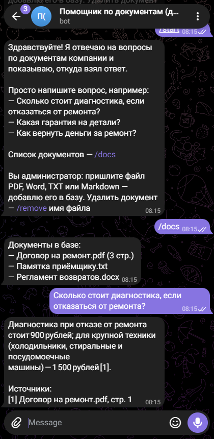
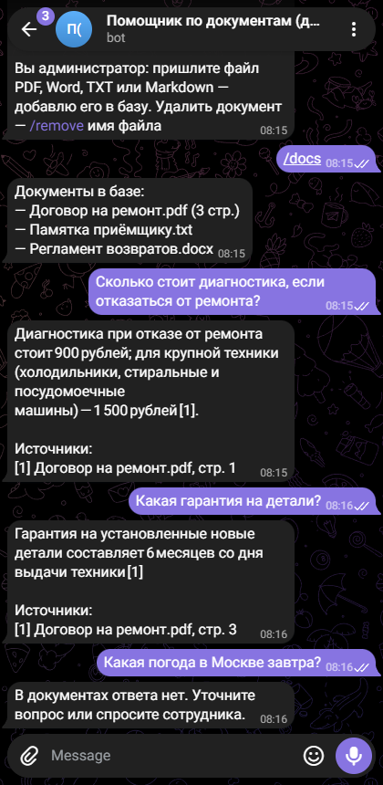

# ИИ-помощник по документам — Telegram-бот и запуск из командной строки

Бот отвечает на вопросы по документам компании: договорам, регламентам,
инструкциям, прайсам. Сотрудник или клиент пишет вопрос своими словами —
бот находит нужный пункт и отвечает коротко, со ссылкой на документ и
страницу. Если в документах ответа нет, бот так и говорит, а не выдумывает.

- **Форматы** — PDF (ссылка на страницу), Word (.docx, вместе с таблицами),
  TXT и Markdown. Скан PDF без текстового слоя бот не примет и скажет
  об этом: распознавание сканов — под заказ.
- **Ответ только по документам** — модель видит лишь найденные фрагменты,
  и её просят ставить номер фрагмента после каждого факта; номера, которых
  не было, бот выбрасывает.
- **Документы меняет администратор** — присылает файл боту, и он сразу
  ищется; файл с тем же именем заменяет прежний. Удалить — командой
  `/remove имя файла`. Список — `/docs`. Файлы, положенные в папку
  вручную, бот увидит после перезапуска.
- **Любая модель** — подходит всё, что говорит на API в формате OpenAI:
  бесплатные модели OpenRouter и Groq, OpenAI, YandexGPT через совместимый
  API, своя модель в Ollama. Сменить модель — одна строка в `.env`.

> Это демо: сервисный центр «ТехноДом», его договор, регламент и памятка
> выдуманы (папка `samples/`).

## Как выглядит

| Вопрос по договору | Гарантия и вопрос мимо документов |
|---|---|
|  |  |

Снимки — настоящая переписка с тестовым ботом в Telegram, ответы дала
бесплатная модель. Весь диалог от /start одним снимком —
[здесь](docs/screens/ves-dialog.png).

## Как запустить

Нужен Python 3.11+.

```bash
python -m venv .venv
.venv/bin/pip install -r requirements.txt
cp .env.example .env          # вписать адрес, ключ и имя модели
.venv/bin/python -m docassist ask "Какая гарантия на детали?"
.venv/bin/python -m docassist bot          # Telegram-бот
```

Что в `.env`:

- `LLM_BASE_URL`, `LLM_API_KEY` — сервис модели; примеры адресов — в
  `.env.example`. Для своей модели в Ollama ключ не нужен.
- `LLM_MODEL` — имя модели у этого сервиса. Чтобы поставить другую модель,
  меняется только эта строка.
- `LLM_MAX_TOKENS` — сколько токенов модель может потратить на ответ, по
  умолчанию 1500; «думающим» моделям нужно больше.
- `DOCS_DIR` — папка с документами; по умолчанию выдуманные из `samples/`.
  Относительный путь считается от папки проекта, а не от текущей. Сюда же
  бот кладёт документы, которые присылает администратор. Для одного запуска
  папку можно задать ключом: `python -m docassist --docs путь ask "вопрос"`;
  относительный путь у ключа считается уже от текущей папки.
- `TELEGRAM_TOKEN` — токен бота от @BotFather, нужен только для `bot`;
  `ADMIN_IDS` — числовые id администраторов через запятую или пробел, только им
  можно загружать и удалять документы.

## Как устроено

```
docassist/
  config.py     настройки из .env
  loader.py     чтение PDF по страницам, Word с таблицами, текста
  search.py     нарезка на фрагменты и поиск с учётом словоформ (без сети)
  llm.py        клиент модели в формате OpenAI: повторы при перегрузке, понятные ошибки
  assistant.py  база документов, вопрос → фрагменты → ответ со ссылками
  tg.py         Telegram-бот на aiogram
  __main__.py   запуск: ask и bot
samples/        выдуманные документы для демо
tools/          make_samples.py — сборка документов в samples/
docs/           снимки чата и описание для портфолио
tests/          настройки, чтение, поиск, клиент модели, ответы, командная строка, бот целиком
```

Поиск работает на месте, без платных сервисов: «гарантии» и «гарантия»
находят один и тот же пункт, а «сколько длится ремонт» — пункт
про срок ремонта. В модель уходят только пять
самых подходящих фрагментов — ответ быстрый и дешёвый даже на большой базе.
Если в документах нет ни одного слова из вопроса, модель вообще не
вызывается. Перегрузка сервиса модели — бот ждёт и повторяет; модель
недоступна — пользователь видит вежливое «попробуйте через минуту», а
подробности уходят в журнал.

## Проверки

- **Живой прогон** — вопросы со снимков заданы этому боту, ответы дала
  бесплатная модель: цены, сроки и условия совпали с документами, на
  вопросы не по документам — «ответа нет».
- **Тесты без сети** — чтение трёх форматов и битых файлов, поиск по
  словоформам, клиент модели на местном сервере (повторы, неверный ключ,
  пустой ответ), разбор ссылок в ответе, бот через настоящий диспетчер
  aiogram: вопросы, загрузка и удаление документов, отказ не администратору.
- **Telegram вживую** — тестовый бот: /start, список документов, вопрос
  с ответом и источниками, «ответа нет» на вопрос мимо документов, загрузка
  файла администратором, вопрос по нему и удаление.

```bash
.venv/bin/pip install -r requirements-dev.txt
.venv/bin/pytest
.venv/bin/ruff check .
```

Пересобрать документы: `.venv/bin/python tools/make_samples.py`.
Для `make_samples.py` нужны fpdf2 (ставится из `requirements-dev.txt`) и
шрифты DejaVu в `/usr/share/fonts/truetype/dejavu/`.

## Что можно добавить под заказ

Распознавание сканов, смысловой поиск на векторах для баз от сотен
документов, память диалога для уточняющих вопросов, ответы в MAX и на
сайте, разные базы для разных отделов, выгрузка вопросов без ответа — чтобы
видеть, каких документов не хватает.
